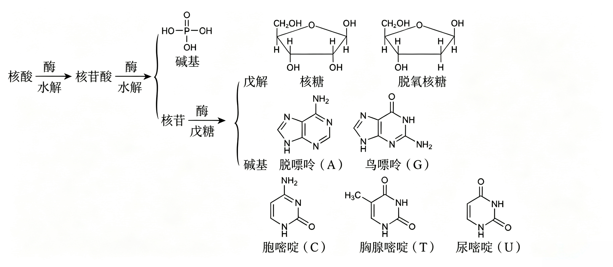

# 06 · 生物大分子

**蛋白质**、**核酸**和**多糖**是3类主要的生物大分子

## 糖类

1. 定义：指多羟基醛或多羟基酮以及能水解生成它们的物质

2. 分类

   多糖 $\ce{->[水解]}$ 低聚糖 $\ce{->[水解]}$ 单糖
   1. 单糖：葡萄糖、果糖、核糖、脱氧核糖等
      1. 按照分子中所含碳原子数的多少，单糖可以分为丙糖、丁糖、戊糖（如核糖、脱氧核糖）和己糖（如葡萄 糖、半乳糖、果糖）等

      2. 按照所含官能团的不同，单糖又可以分为醛糖和酮糖

   2. 低聚糖（也称寡糖）：蔗糖、麦芽糖、乳糖等

   3. 多糖：淀粉、纤维素、甲壳质等

   > 低聚糖和多糖在一定条件下可以水解生成单糖；单糖一般就是多羟基醛或多羟基酮，不能再水解

### 单糖

**葡萄糖与果糖的比较**

|        | 分子式         | 结构简式                   | 官能团           | 类别     | 溶解性                           |
| ------ | -------------- | -------------------------- | ---------------- | -------- | -------------------------------- |
| 葡萄糖 | $\ce{C6H12O6}$ | $\ce{CH2OH(CHOH)4CHO}$     | $\ce{-OH、-CHO}$ | 多羟基醛 | 水中溶解，乙醇中稍溶，乙醚中不溶 |
| 果糖   | $\ce{C6H12O6}$ | $\ce{CH2OH(CHOH)3COCH2OH}$ | $\ce{-OH、-CO-}$ | 多羟基酮 | 在水、乙醇、乙醚中均易溶         |

**葡萄糖的化学性质**

1. 氧化反应

   $\ce{CH2OH(CHOH)4CHO +2[Ag(NH3)2]OH->[\Delta]CH2OH(CHOH)4COONH4 +2Ag v +3NH3 +2H2O}$

   $\ce{CH2OH(CHOH)4CHO +2Cu(OH)2 +NaOH->[\Delta]CH2OH(CHOH)4COONa +Cu2O v +3H2O}$

2. 加成反应

   $\ce{}$ $\ce{CH2OH(CHOH)4CHO +H2->[催化剂][\Delta]CH2OH(CHOH)4CH2OH}$

3. 发酵反应

   $\ce{C6H12O6->[酒化酶]2C2H5OH +2CO2 ^}$

4. 生理反应——人体主要供能反应

   $\ce{C6H12O6(s) +6O2(g)->6CO2(g) +6H2O(l)\qquad\Delta=-2804kJ\cdot mol^{-1}}$

### 二糖

1. 常见二糖
   1. 蔗糖：无色晶体，易溶于水，较难溶于乙醇，甜度仅次于果糖，是重要的甜味剂，非还原糖，无法与 $\ce{Cu(OH)2}$ 反应

   2. 麦芽糖：由两分子葡萄糖脱水形成，主要存在于发芽的谷粒和麦芽中。含有 $\ce{-CHO}$，属于还原糖

2. 水解反应

   $$
   \begin{matrix}
   \ce{&C12H22O11&+ \space H2O->[酶或酸]&C6H12O6& +&C6H12O6&} \\
   &葡萄糖 & &蔗糖 & & 果糖
   \end{matrix}
   $$

   $$
   \begin{matrix}
   \ce{&C12H22O11&+H2O->[酶或酸]&2C6H12O6}\\&麦芽糖&&葡萄糖
   \end{matrix}
   $$

### 多糖

1. 淀粉与纤维素的组成

   |                  | 淀粉                          | 纤维素                        |
   | ---------------- | ----------------------------- | ----------------------------- |
   | 分子式           | $\ce{(C6H10O5)_n}$            | $\ce{(C6H10O5)_n}$            |
   | $n$ 值大小       | 大                            | 更大                          |
   | 结构特点         | 无 $\ce{-CHO}$，有 $\ce{-OH}$ | 无 $\ce{-CHO}$，有 $\ce{-OH}$ |
   | 水解最终产物     | 葡萄糖                        | 葡萄糖                        |
   | 性质差别         | 遇碘变蓝，在人体内可水解      | 在人体内不能水解              |
   | 是否为纯净物     | 否                            | 否                            |
   | 是否为同分异构体 | 否                            | 否                            |

2. 化学性质
   1. 水解反应

      $$
      \begin{matrix}\ce{&(C6H10O5)_n&+nH2O->[酶或酸]&nC6H12O6}\\&淀粉、纤维素&&葡萄糖\end{matrix}
      $$

   2. 淀粉的特征反应：常温下，遇碘变蓝

   3. 两者均不发生银镜反应

3. 用途
   1. 淀粉：食物的重要组成成分，是主要供能物质；还可用于制备葡萄糖、酿醋、酿酒等

      纤维素：可用于纺织工业、造纸工业，制硝酸纤维、醋酸纤维等

> 实验：判断淀粉的水解程度
>
> 1. 实验原理：淀粉在酸作用下发生水解反应最终生成葡萄糖，反应物淀粉遇碘变蓝色，不能发生银镜反应；产物葡萄糖遇碘不变蓝，能发生银镜反应
> 2. 实验步骤：
>
> 
>
> 3. 实验现象及相关结论
>
>    |     | 现象 A     | 现象 B       | 结论         |
>    | --- | ---------- | ------------ | ------------ |
>    | 1   | 未出现银镜 | 溶液变蓝色   | 淀粉尚未水解 |
>    | 2   | 出现银镜   | 溶液变蓝色   | 淀粉部分水解 |
>    | 3   | 出现银镜   | 溶液不变蓝色 | 淀粉完全水解 |
>
>    > 说明：
>    >
>    > 1. 验证水解产物时，首先要加入 $\ce{NaOH}$ 溶液中和后再进行实验
>    > 2. 要验证混合液中是否还有淀粉应直接取水解液加碘水，而不能在加入 $\ce{NaOH}$ 中和后再加碘水，因碘水与 $\ce{NaOH}$ 溶液反应

## 蛋白质

### 氨基酸

1. $\ce{\alpha}-$ 氨基酸
   1. 结构特点：羧基和氨基连在同一个碳原子上

   2. 物理性质：天然的氨基酸均为无色晶体，熔点较高，在 200~300 ℃ 熔化时分解。除少数外一般都能溶于水，而难溶于乙醇、乙醚等有机溶剂

2. 氨基酸的化学性质
   1. 氨基酸的两性：既能和强酸反应，又能和强碱反应

      $\ce{CH2(NH2)-COOH +NaOH->CH2(NH2)-COONa +H2O}$

      $\ce{CH2(NH2)-COOH +HCl->CH2(NH3Cl)-COOH}$

   2. 成肽反应

   

### 蛋白质

1. 蛋白质的组成与结构
   1. 元素：$\ce{C、H、O、N、(S、P)}$

   2. 高分子化合物：蛋白质是由氨基酸通过缩聚反应产生的，蛋白质属于高分子化合物

   3. 所含官能团：肽键（ ），多肽链两端存在氨基和羧基

2. 双性：既能和强酸反应，又能和强碱反应

3. 水解：蛋白质 $\ce{->[酸、碱或酶]}$ 多肽类 $\ce{->[逐步水解]}$ 氨基酸

4. **盐析（物理变化）**
   1. 条件：加人浓的轻金属盐溶液，如 $\ce{(NH4)2SO4、Na2SO4}$ 等

   2. 结果：蛋白质的溶解度降低而从溶液中析出

   3. 特点：发生可逆的物理过程，加水稀释沉淀重新溶解，活性不变

   4. 应用：采用多次盐析和溶解，可以分离提纯蛋白质

5. **变性（化学变化）**
   1. 影响因素：
      1. 物理因素：加热、加压、搅拌、振荡、紫外线照射、超声波等

      2. 化学因素：强酸、强碱、重金属盐、某些有机物（甲醛、酒精、苯甲酸等）

   2. 结果：蛋白质的性质和生理功能发生改变而形成沉淀
   3. 特点：发生不可逆的化学过程

   4. 应用：
      1. 乙醇、碘酒杀菌消毒的原理是使细菌、病毒蛋白质变性死亡

      2. 食物加热烹调使蛋白质变性，利于酶发挥作用使其消化

6. 显色反应：浓硝酸与某些蛋白质发生显色（黄色）反应，可用于蛋白质的检验

7. 灼烧：产生烧焦羽毛的气味，可以用来鉴别蛋白质

## 核酸

**核酸** 是一类含磷的生物高分子化合物，相对分子质量可达十几万至几百万，因具有酸性而得名；在生物体的生长、繁殖、遗传、变异等生命现象中起决定性作用

### 核酸的组成

1. 核酸是由许多 **核苷酸** 单体形成的聚合物，可看成 **磷酸、戊糖和碱基** 通过一定方式结合而成的生物大分子

   碱基 + 戊糖 $\ce{->[缩合]}$ 核苷 $\ce{->[磷酸][缩合]}$ 核苷酸 $\ce{->[聚合]}$ 核酸

   

   > 核酸逐步水解得到核苷酸，核苷酸继续水解得到核苷与磷酸，核苷水解得到戊糖与碱基

2. 按天然核酸中所含戊糖的不同分类

   |          | 脱氧核糖核酸 DNA | 核糖核酸 RNA |
   | -------- | ---------------- | ------------ |
   | 戊糖     | 脱氧核糖         | 核糖         |
   | 结构     | 双螺旋           | 一般为单链   |
   | 碱基配对 | A—T、G—C        | A—U、G—C     |
   | 主要功能 | 生物遗传信息的载体 | 根据 DNA 提供的信息控制体内蛋白质的合成 |

> 含氮碱基：腺嘌呤 A、鸟嘌呤 G、胞嘧啶 C、胸腺嘧啶 T（DNA）、尿嘧啶 U（RNA）

### 核酸的结构

1. DNA 分子的双螺旋结构
   1. 由两条多聚核苷酸链组成，两条链平行盘绕形成双螺旋

   2. 每条链中脱氧核糖和磷酸交替连接，排列在外侧；碱基排列在内侧

   3. 两条链上的碱基通过 **氢键** 作用，遵循 **碱基互补配对原则**：A—T、G—C

2. RNA 分子一般呈单链状结构
   1. 以核苷酸为基本构成单位

   2. A—U、G—C，遵循碱基互补配对原则

### 核酸的生物功能

1. 核酸是生物体 **遗传信息的载体**；有一定碱基排列顺序的 DNA 片段含有特定的遗传信息，被称为 **基因**

2. RNA 主要负责传递、翻译和表达 DNA 所携带的遗传信息

3. 细胞繁殖分裂过程中会发生 DNA 分子的 **复制**，使遗传信息精确地传递给下一代，并通过控制蛋白质的合成影响生物体特定性状的发生和发育
