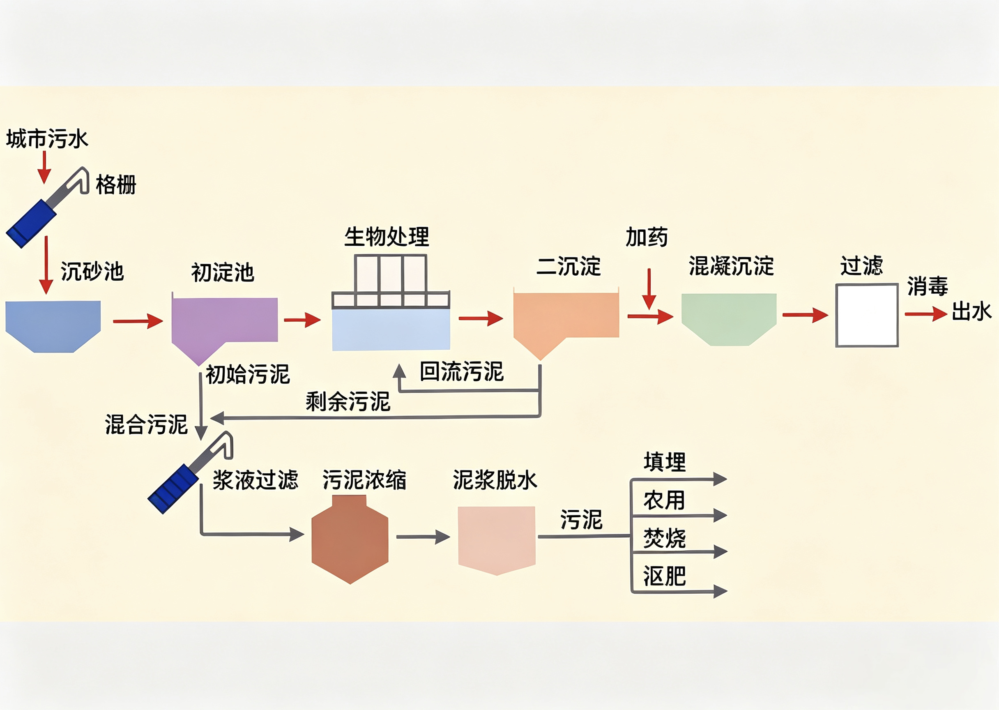

# 07 · 化学与 STSE

$\text{STSE = Science + Technology + Society + Environment}$

## 金属及其化合物

| 重要性质                                                                                                   | 应用                                                    |
| ---------------------------------------------------------------------------------------------------------- | ------------------------------------------------------- |
| $\ce{Na2O2}$ 与 $\ce{H2O}$、 $\ce{CO2}$ 反应均生成 $\ce{O2}$                                               | 作供氧剂                                                |
| $\ce{Na2CO3}$ 水解使溶液显碱性，可促进油脂水解                                                             | 用热的纯碱溶液洗去油污                                  |
| $\ce{NaHCO3}$ 受热分解生成 $\ce{CO2}$，能与酸反应                                                          | 用作焙制糕点的膨松剂、胃酸中和剂                        |
| $\ce{Al}$ 具有良好的延展性和抗腐蚀性                                                                       | 常用铝箔包装物品                                        |
| 常温下，$\ce{Al}$、 $\ce{Fe}$ 遇浓硫酸或浓硝酸钝化                                                         | 盛装、运输浓硫酸或浓硝酸                                |
| $\ce{Al}$ 与 $\ce{Fe2O3}$ 反应放出大量的热                                                                 | 用于焊接钢轨                                            |
| $\ce{MgO}$、 $\ce{Al2O3}$ 熔点高                                                                           | 作耐高温材料                                            |
| $\ce{Al^{3+}}$ 水解生成的氢氧化铝胶体具有吸附性，$\ce{NaHCO3}$ 溶液和 $\ce{H2SO4}$ 溶液反应生成 $\ce{CO2}$ | 明矾作净水剂（混凝剂）                                  |
| 明矾溶液显酸性                                                                                             | 作泡沫灭火器，利用明矾溶液清除铜镜表面的铜锈            |
| $\ce{Al(OH)3}$ 有弱碱性                                                                                    | 中和胃酸，用作抗酸药                                    |
| $\ce{Fe}$ 具有还原性                                                                                       | 防止食品氧化变质                                        |
| $\ce{Fe2O3}$ 是红棕色粉末                                                                                  | 作红色颜料                                              |
| $\ce{Fe^{3+}}$ 水解生成的氢氧化铁胶体具有吸附性                                                            | 铁盐作净水剂（混凝剂）                                  |
| $\ce{K2FeO4}$ 是强氧化剂，还原产物 $\ce{Fe^{3+}}$ 水解生成氢氧化铁胶体                                     | 作新型消毒剂、净水剂                                    |
| $\ce{FeCl3}$ 溶液具有较强的氧化性                                                                          | 腐蚀铜刻制印刷电路板                                    |
| $\ce{CuSO4}$ 能使蛋白质变性                                                                                | 与石灰乳配制成波尔多液用于树木杀虫                      |
| $\ce{BaSO4}$ 不溶于水，不与胃酸反应，且有良好的吸收X射线的效果                                             | 在医疗上进行胃部造影前，$\ce{BaSO4}$ 作患者服用的“钡餐” |

## 非金属及其化合物

| 重要性质                                                                               | 应用                                                     |
| -------------------------------------------------------------------------------------- | -------------------------------------------------------- |
| 浓硫酸具有吸水性                                                                       | 作干燥剂（不能干燥 $\ce{NH3}$、 $\ce{H2S}$、 $\ce{HI}$） |
| 生石灰、无水氯化钙能与水反应                                                           | 作（食品）干燥剂                                         |
| $\ce{P2O5}$ 能与水反应                                                                 | 作干燥剂（不可干燥食品，可干燥HNO3）          |
| 硅具有半导体性能                                                                       | 制作芯片和太阳能电池                                     |
| $\ce{SiO2}$ 存在光的全反射                                                             | 制作光导纤维                                             |
| $4\ce{HF} + \ce{SiO2} \xlongequal{} 2\ce{H2O} + \ce{SiF4}$                             | 用氢氟酸刻蚀玻璃                                         |
| $\ce{ClO2}$ 具有较强的氧化性，且不会与水中微量有机物生成致癌性物质(优于Cl2) | 用于自来水的杀菌消毒                                     |
| 次氯酸盐具有强氧化性                                                                   | 作杀菌消毒剂、漂白剂                                     |
| 碘酸钾在常温下稳定                                                                     | 食盐中的加碘物质                                         |
| $\ce{NH4HCO3}$、 $\ce{NH4NO3}$ 是可溶的含氮化合物                                      | 用作氮肥                                                 |
| 浓氨水具有挥发性和还原性                                                               | 检验输送 $\ce{Cl2}$ 的管道是否漏气                       |
| $\ce{SO2}$ 具有漂白性                                                                  | 用于漂白纸浆、毛、丝等(可逆)                             |
| 硅酸钠的水溶液是一种无机黏合剂                                                         | 盛放碱性溶液的试剂瓶不能用玻璃塞                         |
| 干冰升华吸收大量的热                                                                   | 人工降雨                                                 |
| 液氨汽化吸收大量的热                                                                   | 做制冷剂                                                 |

## 环境污染

| 污染名称     | 主要污染物及形成原理                                                                                                                                                                                             |
| ------------ | ---------------------------------------------------------------------------------------------------------------------------------------------------------------------------------------------------------------- |
| PM2.5        | 大气中直径小于或等于 2.5 微米的颗粒物，也称为可入肺颗粒物                                                                                                                                                        |
| 雾霾         | 混合了 $\ce{SO2}$、 $\ce{NO}$ 和可吸入颗粒物的雾气                                                                                                                                                               |
| 酸雨         | 主要形成原理（$\ce{CO2}$不是导致酸雨的气体）：  $\ce{SO2 + H2O \xlongequal{} H2SO3}$, $2\ce{H2SO3 + O2 \xlongequal{} 2H2SO4}$; $\ce{2NO + O2 \xlongequal{} 2NO2}$, $3\ce{NO2 + H2O \xlongequal{} 2HNO3 + NO}$ |
| 光化学烟雾   | 机动车尾气中的碳氢化合物和氮氧化物在光照条件下生成复杂的污染物                                                                                                                                                   |
| 臭氧空洞     | $\ce{NO2}$、氟氯代烷等与臭氧发生作用，导致了臭氧层的损耗                                                                                                                                                         |
| 水体污染     | 过度施用化肥和农药，工业“三废”和生活污水的随意排放，富营养化可引起“水华”或“赤潮”                                                                                                                                 |
| 温室效应气体 | 大量使用化石燃料导致大气中的 $\ce{CO2}$ 浓度增加，产生温室效应，导致地表温度上升                                                                                                                                 |

## 绿色化学

绿色化学又称 **环境友好化学**，核心是改变“先污染后治理”的观念和做法，利用化学原理和技术手段，**从源头上** 减少或消除产品在生产与应用中涉及的有害化学物质

| 原则 | 含义 |
| ---- | ---- |
| 原子经济 | 反应物的原子全部转化为期望的最终产物，没有副反应、不生成副产物，原子利用率为 $100\%$ |
| 减量化 reduce | 减少原料与能源消耗，减少废弃物排放 |
| 再利用 reuse | 产品或中间产物多次重复使用 |
| 再循环 recycle | 废弃物回收后转化为可利用资源 |

> 1. 最理想的“原子经济”常见于化合反应、加聚反应等无副产物的反应
> 2. 开发和利用自然资源必须遵循减量化、再利用、再循环的原则，践行绿色发展理念
> 3. 设计有机合成路线时，应选择步骤少、原料易得、产率高、污染少、尽量实现零排放的路线

## 污水处理

| 方法 | 原理 | 处理对象 |
| ---- | ---- | -------- |
| 物理法 | 沉淀、过滤、吸附、气浮等 | 不溶性悬浮物、泥沙 |
| 化学法 | 中和法、氧化还原法、沉淀法 | 酸碱性废水、重金属离子、可氧化还原的污染物 |
| 生物法 | 利用微生物分解有机物 | 有机废水、生活污水 |

> 1. 污水须经处理达到排放标准后再排放，并控制、减少污水的任意排放
> 2. 含 $\ce{N}$、$\ce{P}$ 过多的污水排入水体会造成富营养化，引起“水华”（淡水）或“赤潮”（海水）
> 3. 明矾、铁盐水解生成的胶体可吸附水中悬浮杂质，作净水剂（混凝剂）
