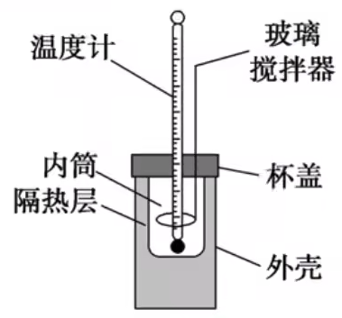

# 01 · 热化学概述

## 化学反应中的能量

### 内能，$U$

1. 定义：在热力学中，一个体系所具有的能量叫这个体系的内能。
   体系的内能包括分子总动能和分子总势能。
2. 单位：$\mathrm{J}$，焦耳，简称焦；$\mathrm{cal}$，卡路里，简称卡；$1\ \text{cal} = 4.184\ \ce{J}$
3. 特点
   - 内能是一种**状态函数**，也就是说，
     它的数值只取决于系统当前的状态，与系统如何达到这一状态无关。
     我们用 ∆U 表示系统从内能为 $U_{initial}$ 的初态 $initial$ 变化
     到内能为 $U_{final}$ 的末态 $final$ 时，内能的变化量：
   $$
   \Delta U = U_{final} - U_{initial}
   $$

### 热量，$Q$

1. 定义：在一个热力学途径中，热量指因**温度不同**而在系统与环境之间交换或传递的能量
2. 单位：$\mathrm{J}$，焦耳，简称焦；$\mathrm{cal}$，卡路里，简称卡。
3. 分类
   1. 放热过程：指向周围环境**释放**热量的过程。
      - 常见的放热过程：凝固、液化、凝华，大多数化合反应，酸碱中和反应，
        强酸强碱浓溶液的稀释，钢铁生锈、食物腐败、可燃物燃烧，铝热反应，双氧水、硝酸铵、‌氯酸钾的分解等。
   2. 吸热过程：指从周围环境中**吸收**热量的过程。
      - 常见的吸热过程：熔化、汽化、升华，大部分分解反应，
        弱电解质的电离与水解，铵盐与强碱，碳与水蒸气、二氧化碳反应
4. 注意:

   为避免冗长而别扭的说法，我们说：
   在放热过程中，能量“以热的形式”传递给周围环境；
   在吸热过程中，能量则“以热的形式”从周围环境传入系统。
   但必须牢记，**热是一种过程**（由于温差而发生的能量传递），
   而不是一种实体。

### 焓，$H$

1. 定义

   $$
   H = U + pV
   $$

   其中，$U,\ p,\ V$分别为体系的内能、压强和体积。

2. 单位：$\mathrm{J}$，焦耳，简称焦；$\mathrm{cal}$，卡路里，简称卡。

3. 特点
   - 由于$U,\ p,\ V$均为状态函数，所以$H$也为状态函数，
     所以焓变$\Delta H$是体系始末状态的函数，而与达到终态的路径无关，即：

$$
\Delta H = H_{final} - H_{initial}
$$

## 热化学方程式

### 定义

能表明反应所释放或吸收的热量的化学方程式。
本人理解热化学方程式一般按照如下方式理解：测试

$$
\textbf{化学方程式} + \textbf{物态} + \textbf{热效应}
$$

其中：

- $\textbf{化学方程式}$：反映了该化学反应的物质变化；
- $\textbf{物态变化}$：反映了该化学反应的物态变化；
- $\textbf{热效应}$：反映了该化学反应的能量变化。

### 意义

以氢气燃烧生成水为例：

$$
2\ce{H2(g)} + \ce{O2(g)} \xlongequal{} 2\ce{H2O(l)}\quad \Delta H = -571.6\ \mathrm{kJ\cdot mol^{-1}}
$$

该方程式表示每发生$\mathrm{1\ mol}$上述反应，
即“在$\mathrm{298.15K, 101kPa}$条件下，每$\mathrm{2\ mol}$ 氢气与$\mathrm{1\ mol}$ 氧气发生反应生成$\mathrm{2\ mol}$液态水”，
放出$\mathrm{571.6\ kJ}$的热量。

### 注意事项

1. **需注明反应条件**：反应热与测定条件(温度、压强等)有关；
   绝大多数反应是在25 ℃、101 kPa下进行的，可不特别注明；
2. **需注明反应物和生成物的聚集状态**：因为物质的聚集状态不同时，它们所具有的内能、焓也均不同。下表列出了常见的物质聚集状态的符号：
   | $\ce{s}$ | $\ce{l}$ | $\ce{g}$ | $\ce{aq}$ |
   | :------: | :------: | :------: | :-------: |
   |   固体   |  纯液体  |   气体   |  水溶液   |
3. 热化学方程式一般不标注"$\ce{^}$” 、"$\ce{v}$” 以及"点燃” “$\ce{\Delta}$” 等反应条件；
4. 热化学方程式的化学计量数表示参加反应的物质的**物质的量**，所以热化学方程式的化学计量数可以为分数；
5. 不论化学反应是否可逆，热化学方程式中的$\Delta H$都表示反应进行到底时的能量变化。

## 热化学基本概念

### 燃烧热

1. 定义：$\mathrm{101\ kPa}$时，$\mathbf{1\ mol}$ 纯物质
   **完全燃烧**生成指定产物时所放出的热量，叫做该物质的燃烧热。
2. 符号与单位：$\Delta_{c} H$ ( $c$表示$Combustion$ );
   $\mathrm{kJ}\ \cdot\ \mathrm{mol^{-1}}$或$\mathrm{kJ/mol}$
3. 要点：
   - $\mathbf{101\ kPa}$及特定温度
   - $\mathbf{1\ mol}$ 纯物质
   - **完全燃烧**生成指定产物，常见元素的指定产物见下表

   | 元素     | $\ce{C}$      | $\ce{H}$      | $\ce{S}$      | $\ce{N}$     |
   | -------- | ------------- | ------------- | ------------- | ------------ |
   | 指定产物 | $\ce{CO2(g)}$ | $\ce{H2O(l)}$ | $\ce{SO2(g)}$ | $\ce{N2(g)}$ |

4. 示例：

   $\ce{CO(g) + \frac{1}{2}O2(g) \xlongequal{} CO2(g)}\quad\Delta H=-283\ \mathrm{kJ\cdot mol^{-1}}$
   $\ce{2CO(g) + O2(g) \xlongequal{} 2CO2(g)}\quad\Delta H=-566\ \mathrm{kJ\cdot mol^{-1}}$

5. 燃烧热的测量

   将待测物质放在一个充满氧气的密封金属容器（称为氧弹）内，
   再将此容器置于盛有一定量水的量热计内筒中，
   通过点火装置使氧弹中物质燃烧，反应放出的热量会使氧弹外面的水温升高。
   用温度计测量水温的变化，即可计算出此反应放出的热量。

### 中和热

1. 定义:

   $$
   \ce{H+(aq)} + \ce{OH-(aq)} \xlongequal{} \ce{H2O(l)}\quad \Delta H = -57.3\ \mathrm{kJ\cdot mol^{-1}}
   $$

   即在稀溶液及$\mathrm{298.15 K, 101 kPa}$的条件下，每$\mathrm{1\ mol}\ \ce{H+(aq)}$
   与$\mathrm{1\ mol\ \ce{OH-(aq)}}$发生反应生成$\mathrm{1\ mol}$液态水放出$57.3\ \mathrm{kJ}$热量

2. 中和反应反应热的测定实验
   1. 实验目的：测量中和反应的反应热
   2. 实验原理：

      $Q=cm\Delta t$

      其中，$Q$ 是中和反应放出的热量，$m$ 是反应混合液的质量，$C$ 是反应混合液的比热容，$Δt$ 是反应前后溶液温度的差值

   3. 实验装置：
       <figure style="text-align: center;">
         
         <figcaption>图 8.1.1  中和反应反应热测量实验装置图</figcaption>
       </figure>
   4. 实验步骤：
      1. 用量筒量取 $50\ \mathrm{mL}$ $0.50\ \mathrm{mol/L}$盐酸，打开杯盖，倒入量热计的内筒，盖上杯盖，插入温度计，测量并记录盐酸的温度.用水把温度计上的酸冲洗干净，擦干备用
      2. 用另一个量筒量取 $50\ \mathrm{mL}$ $0.55\ \mathrm{mol/L}$\ce{NaOH}$ 溶液，用温度计测量并记录 $\ce{NaOH}$ 溶液的温度
      3. 反应后体系温度的测量打开杯盖，将量筒中的 $\ce{NaOH}$ 溶液迅速倒入量热计的内筒，立即盖上杯盖，插入温度计，用搅拌器匀速搅拌.密切关注温度变化，将最高温度记为反应后体系的温度 ($t_2$)
      4. 重复上述步骤 1 至步骤 3 两次.
   5. 数据处理
      1. 取盐酸温度和氢氧化钠溶液温度的平均值记为反应前体系的温度($t_0$).计算温度差 ($t-t_0$)，将数据填入下表

         | 实验次数 | 起始温度 $t_{1, 0}(\ce{HCl})/^\circ\text{C}$ | 起始温度 $t_{2, 0}(\ce{NaOH})/^\circ\text{C}$ | 平均温度$t_0\ ^\circ\text{C}$ | 终止温度 $t/^\circ\text{C}$ | 温度差$(t-t_0)/^\circ\text{C}$ |
         | -------- | ------------------------------------------------ | ------------------------------------------------- | ----------------------------- | ------------------------------- | ------------------------------ |
         | 1        |                                                  |                                                   |                               |                                 |                                |
         | 2        |                                                  |                                                   |                               |                                 |                                |
         | 3        |                                                  |                                                   |                               |                                 |                                |

      2. 取三次测量所得温度差的平均值作为计算依据
      3. 根据温度差和比热容等计算反应热
      4. 实验数据处理

         为了计算简便，可以近似地认为实验所用酸、碱稀溶液的密度、比热容与水的相同，并忽略量热计的比热容，
         1. $50\ \mathrm{mL}$ $0.50\ \mathrm{mol/L}$盐酸的质量 $m_1=50\ g$，$50\ \mathrm{mL}$ $0.55\ \mathrm{mol/L}$ $\ce{NaOH}$ 溶液的质量 $m_2=50\ g$.
         2. 反应后生成的溶液的比热容 $c=4.18\  J \cdot g^{-1} \cdot ^\circ\text{C}^{-1}$

      5. 计算反应热：

      $$Q=4.18\times10^{-3}\times(50+50)\times(t-t_0)\ \mathrm{kJ}=0.418(t-t_0)\ \mathrm{kJ}$$

   6. 为了提高测定的准确度，应该采取哪些措施?
      1. 隔热层、杯盖等的使用是为了减少热量散失，降低实验误差.
      2. 要使用同一支温度计，避免仪器误差.注意测定一种溶液后必须用水冲洗干净并用滤纸擦干.
      3. 使用不同的量筒分别量取酸碱溶液
      4. 正确读取体积和温度，多次试验求平均值时，若有某一组的实验数据有明显偏差，应直接舍去.
      5. 操作时动作要快，尽量减少热量的散失
      6. 为了保证盐酸完全被中和，采用稍过量的 $\ce{NaOH}$ 溶液.

### 生成焓

1. 定义

   某物质的标准生成焓是指在**标准状态**下，由其组成元素的**参考态**生成$1\ \mathrm{mol}$该化合物的标准反应焓。
   元素的参考态是指在指定温度和 $1\ \mathrm{bar}$压力下最稳定的状态（一般为单质）。

   对于上述关于参考态的一般规定，有一个例外：磷的参考态取白磷，尽管白磷并非最稳定的同素异形体，只是这种元素中较易制得纯品的一种形态。

2. 符号及单位：$\Delta_{f} H$ (其中下标$f$表示$formation$，即生成)；$\mathrm{kJ}\ \cdot\ \mathrm{mol^{-1}}$或$\mathrm{kJ/mol}$
3. 要点
   1. 目标物质的物质的量（即热化学方程式的系数）为$1\ \mathrm{mol}$；
   2. 由元素的指定的稳定状态生成。
4. 示例：

   液态苯的生成热：

   $$
   \ce{6 C(s, graphite) + 3 H2(g) → C6H6(l)\quad \Delta_f H = +49.0 \mathrm{kJ \cdot mol^{-1}}}
   $$

## 盖斯定律

### 定义

由于$\Delta H$是状态函数，只与体系初态和末态有关，与反应路径无关，所以一个反应的焓变，等于将该反应拆分成若干个单独反应后，各反应焓变的总和。

### 应用

部分反应进行很慢，不容易直接发生或是对直接测量反应热造成困难的实验，利用盖斯定律可以**间接**把它们的反应热计算出来。

**例如：**
$$\ce{C (s) + 1/2O2 (g) = CO (g)}\quad \Delta H =\ ? \quad (*)$$

由于$\ce{C (s)}$在燃烧时产物的不确定性，导致该反应的无法直接测得。

但根据盖斯定律，可以利用下列两个反应的 $\Delta H$ 可以间接得到：

$$\ce{C(s) + O2(g) = CO2(g)}\quad \Delta H_1 = -393.5 \text{ kJ/mol}\quad  (8.1.1)$$

$$\ce{CO(g) + 1/2O2(g) = CO2(g)}\quad \Delta H_2 = -283.0 \text{ kJ/mol}\quad (8.1.2)$$

在此温度下，目标方程式满足：

$$
eq.* = eq.8.1.1 - eq.8.1.2
$$

所以反应$\ce{C(s) + 1/2O2(g) = CO(g)}$的$\Delta H$为

$$
\Delta H = \Delta H_1 - \Delta H_2 = -110.5 \text{ kJ/mol}
$$

## 参考资料

[1] ATKINS P, DE PAULA J, KEELER J. Atkins' physical chemistry[M]. 12th ed. Oxford: Oxford University Press, 2023.
