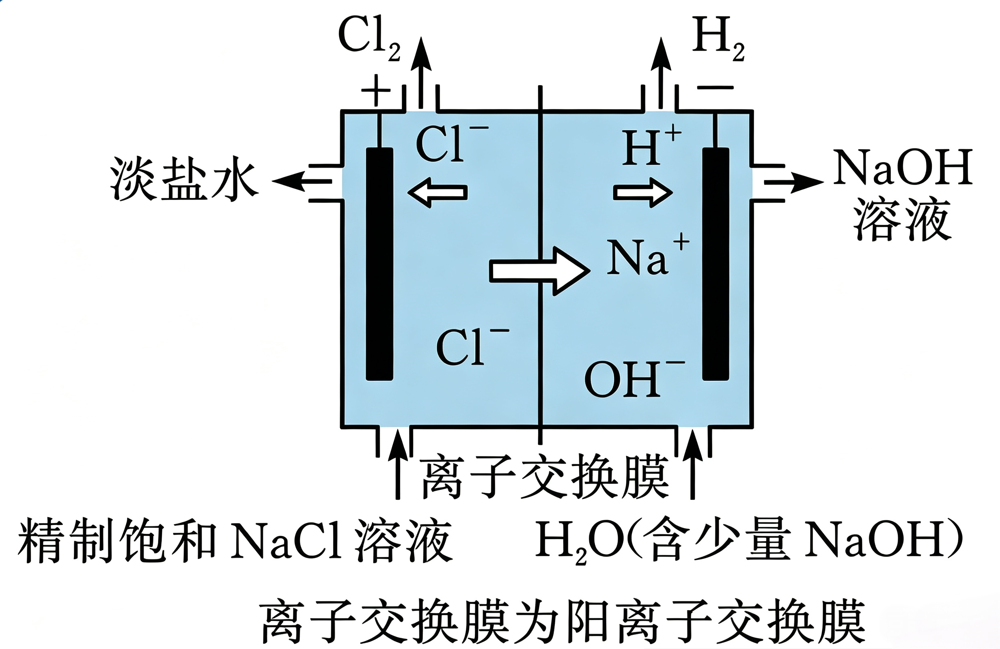
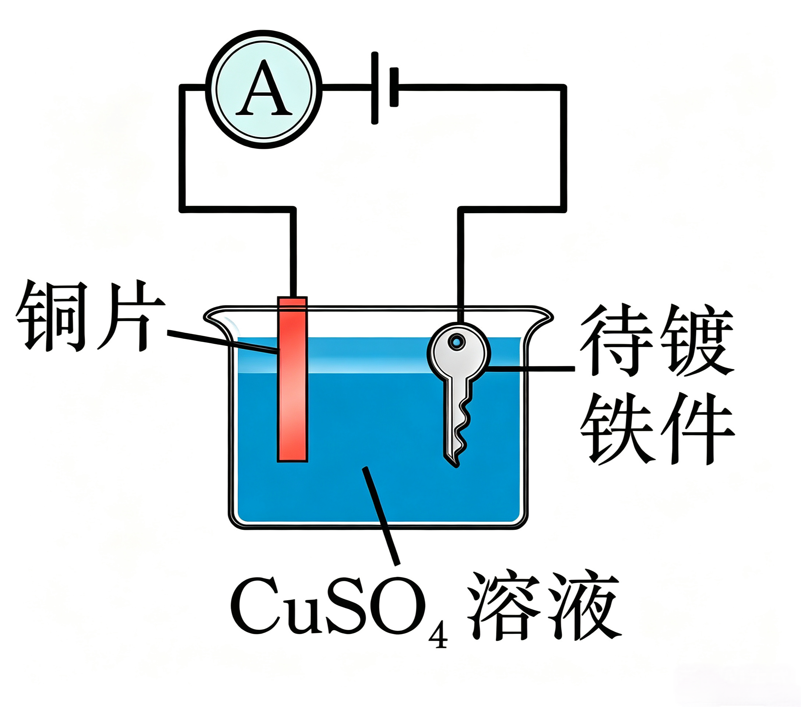
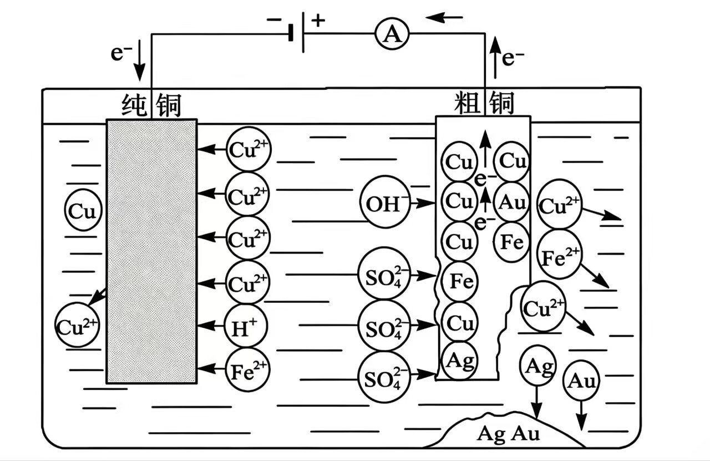

# 06 · 电解的应用 <Badge type="warning" text="整理中" />

## 电解的应用场景

**氯碱工业：**

 

**电镀：**

 

1. 待镀金属作阴极，镀层金属作阳极，用含镀层金属离子的电解质溶液作电镀液。

2. 电镀特点：一增（阴极质量增加）、一减（阳极质量减少）、一不变（电解质溶液浓度） 【且阴极增加的质量与阳极减少的质量相等】

**电解精炼铜：**（粗铜提纯）

1. 电极材料：阳极为粗铜，阴极为纯铜。
2. 电解质溶液：含 $\ce{Cu^2+}$ 的盐溶液 （ 如 $\ce{CuSO4}$ ）

 

**电冶金：** 电解冶炼金属是冶炼活泼金属（如 $\ce{Na}$、$\ce{Mg}$、$\ce{Al}$ 等）的重要方法。电解熔融电解质时，阴极上金属阳离子得电子被还原为金属单质，阳极上阴离子失电子被氧化。

| 电解质（熔融） | 阴极反应                   | 阳极反应                          | 总反应                                                  |
| -------------- | -------------------------- | --------------------------------- | ------------------------------------------------------- |
| $\ce{NaCl}$    | $\ce{Na+ + e^- = Na}$      | $\ce{2Cl^- - 2e^- = Cl2 ^}$       | $\ce{2NaCl(熔融) \xlongequal{电解} 2Na + Cl2 ^}$        |
| $\ce{MgCl2}$   | $\ce{Mg^{2+} + 2e^- = Mg}$ | $\ce{2Cl^- - 2e^- = Cl2 ^}$       | $\ce{MgCl2(熔融) \xlongequal{电解} Mg + Cl2 ^}$         |
| $\ce{Al2O3}$   | $\ce{Al^{3+} + 3e^- = Al}$ | $\ce{2O^{2-} + C - 4e^- = CO2 ^}$ | $\ce{2Al2O3(熔融) + 3C \xlongequal{电解} 4Al + 3CO2 ^}$ |

> **注意**
> 工业电解铝使用**碳素阳极**：阳极上 $\ce{O^{2-}}$ 放电的同时消耗碳素阳极生成 $\ce{CO2}$，故总反应中有碳参加，阳极需定期补充；不要误以为阳极产物是 $\ce{O2}$。冶炼时还需加入冰晶石（$\ce{Na3AlF6}$）作助熔剂，将氧化铝的熔点（$2054\ ^\circ\mathrm{C}$）降低到千摄氏度左右，以减少能耗。
